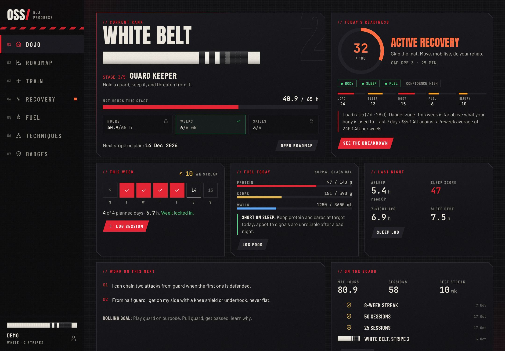
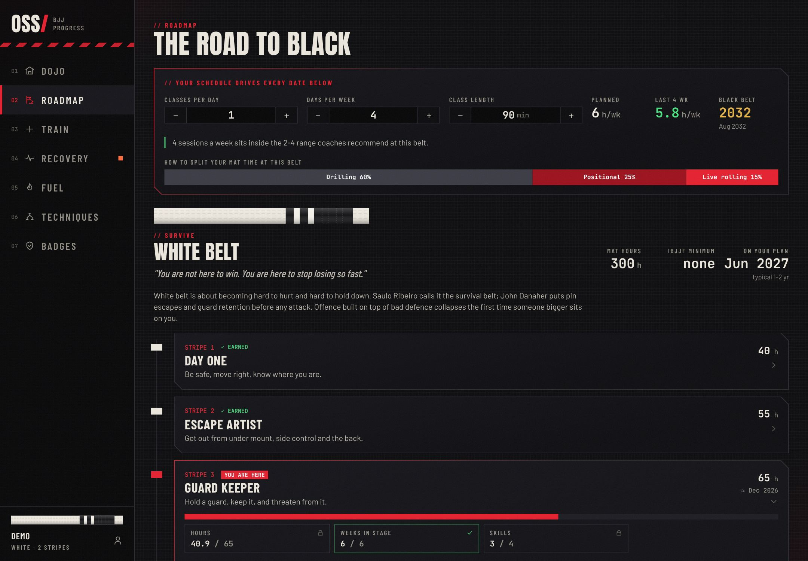
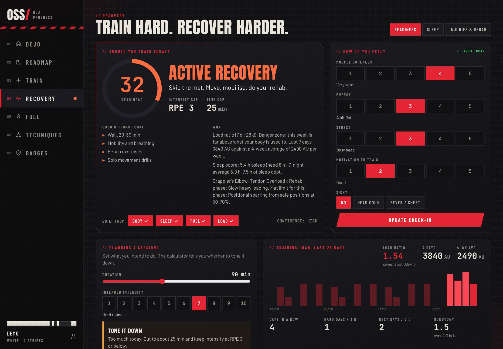
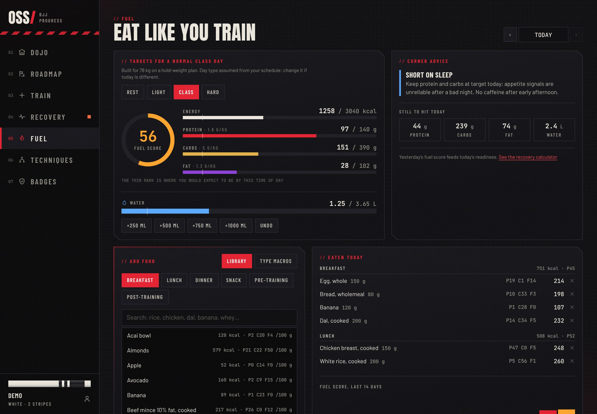

# OSS // BJJ Progress

A local-first training companion for Brazilian Jiu-Jitsu. It builds a belt-by-belt roadmap from your schedule, awards stripes when you have earned them, keeps you consistent, and tells you when to tone it down.



## What it does

| Tab | What you get |
| --- | --- |
| **Dojo** | Current rank, progress through the current stage, today's readiness, this week's sessions, fuel and sleep at a glance. |
| **Roadmap** | 20 documented stages from white belt to black. Each one explains why it exists, what to train, a skills checklist, a rolling goal and the classic mistake. Dates are projected from your schedule and move live as you change it. |
| **Train** | Session log (type, gi/no-gi, minutes, intensity), 26-week heatmap, weekly hours, streaks. |
| **Recovery** | Readiness calculator, sleep log, and an injury library with phased rehab plans you can track. |
| **Fuel** | Food and water log with targets that scale to the day's training, a fuel score and coaching hints. |
| **Techniques** | The position map: proficiency per position from the techniques you drill. |
| **Badges** | Stripes, belt-ready and belt badges, plus consistency milestones. |

Everything is metric and everything stays in a SQLite file on your machine.

| Roadmap | Recovery | Fuel |
| --- | --- | --- |
|  |  |  |

## Quick start

Requirements: Python 3.10+, Node.js 18+.

```bash
bash scripts/start.sh
```

Then open http://localhost:5173. API docs are at http://localhost:8000/docs.

To look around with 14 weeks of sample data instead of an empty app:

```bash
BJJ_DB_URL=sqlite:///./demo.db .venv/bin/python -m scripts.seed_demo
```

```bash
BJJ_DB_URL=sqlite:///./demo.db .venv/bin/uvicorn src.backend.main:app --port 8000
```

```bash
cd src/frontend && npm run dev
```

The demo seeder refuses to touch `bjj_tracker.db`.

## How the logic works

All of it is also explained inside the app, next to the numbers it produces.

### Roadmap and stripes

A stage (one stripe) is complete when three gates are met:

1. **Mat hours** logged in the stage reach its budget. Surplus carries over.
2. **Weeks** in the stage reach the calendar floor. For blue, purple and brown this is the IBJJF minimum time at the belt split across five stages; white has no IBJJF minimum, so the app uses 6 weeks per stage.
3. **Skills**: 80% of the stage checklist is ticked.

The fifth stage of each belt ends in **belt-ready**, never in a new belt. Belts come from your coach; you confirm the promotion in the app.

Projected dates use `classes per day x days per week x class length`, assume 48 training weeks a year, and are never earlier than the calendar floors allow.

| Belt | Hours | IBJJF minimum | Theme |
| --- | --- | --- | --- |
| White | 300 h | none | Survive |
| Blue | 600 h | 24 months | Escape and explore |
| Purple | 500 h | 18 months | The guard and your game |
| Brown | 400 h | 12 months | Pass and polish |

The hour budgets are this app's own model, set so a student training 3 x 90 min a week lands inside commonly reported ranges. No federation publishes hour requirements. Content and sources live in `config/roadmap.json`.

### Readiness calculator

Starts at 100 and subtracts from five capped buckets (`src/backend/recovery.py`):

| Bucket | Max | Built from |
| --- | --- | --- |
| Training load | 40 | Session-RPE load (RPE x minutes), 7-day to 28-day load ratio, days in a row, hard-session density, monotony |
| Sleep | 25 | Last night's sleep score |
| How you feel | 25 | Soreness, energy, stress, motivation, illness |
| Fuel | 15 | Yesterday's fuel score, under-eating streaks, today's hydration |
| Injuries | 30 | Pain level and the limits of the current rehab phase |

Zones: 80+ GO, 65-79 TRAIN SMART, 45-64 TONE IT DOWN, 25-44 ACTIVE RECOVERY, below 25 REST. Hard limits override the score: fever means rest, pain of 7/10 or more means rehab only, under 5 h of sleep caps the day at TONE IT DOWN, and an active injury caps you at what its rehab phase allows.

### Sleep without a wearable

Phone screen-off and first-pickup times track when you fell asleep and woke up well, but over-count how long you slept. A sleep diary is the standard non-wearable method, and its weak point is remembering exact times. The app combines the two: screen times anchor the night, and three diary inputs (time to fall asleep, time awake, how it felt) correct it.

A web app cannot read iOS Screen Time or Android Digital Wellbeing directly; those are only available to native apps. You copy two times across, or use the "Lights out" and "I'm up" buttons.

### Fuel

Targets per day (`src/backend/nutrition.py`): protein 1.8 g/kg (2.2 when cutting), carbohydrate 3 / 4 / 5 / 7 g/kg for rest / light / class / hard days, fat from the remaining energy with a 0.8 g/kg floor, water 35 mL/kg plus 600 mL per training hour. The fuel score weights protein 35, carbs 25, energy 20, water 20.

### Injury library

19 conditions in `config/injuries.json`, each with how it happens in BJJ, symptoms, red flags, typical timelines and a phased rehab plan with exit criteria and a mat-access level per phase. Seeded into SQLite on startup.

This is general education, not medical advice. See a physiotherapist or sports doctor for anything in a red-flag list.

## Project structure

```text
config/
  roadmap.json        Belt stages, rules and sources
  injuries.json       Injury library
  foods.json          Food library (per 100 g)
  skill_tree.json     Position map
scripts/
  start.sh            Start backend and frontend
  seed_demo.py        Sample data for a demo database
src/backend/
  recovery.py         Readiness calculator (pure functions)
  progression.py      Stage gates, awards, date projection
  sleep.py            Sleep estimate and score
  nutrition.py        Targets, fuel score, hints
  consistency.py      Streaks, calendar, milestone awards
  services.py         Database glue
  seed.py             Table creation, migrations, library seeding
  routers/            HTTP API
  tests/              pytest suite
src/frontend/         React, TypeScript, Vite, Tailwind, Zustand
```

## Development

```bash
.venv/bin/python -m pytest src/backend/tests -q
```

```bash
cd src/frontend && npm run build
```

Set `BJJ_DB_URL` to point the backend at a different SQLite file. Existing databases are upgraded in place on startup.
